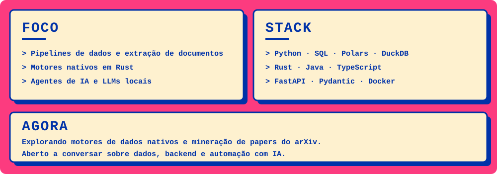
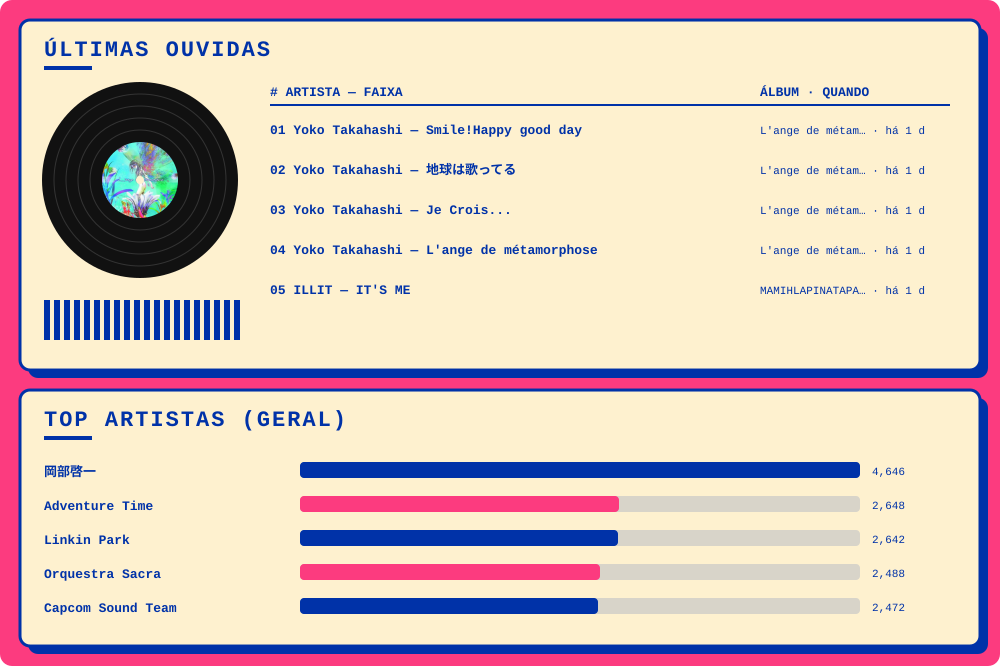

## Projetos em destaque

| Projeto | Descrição | Stack |
| --- | --- | --- |
| [arxiv-research-miner](https://github.com/03s9/arxiv-research-miner) | Mineração de papers do arXiv | Python |
| [native-data-engine-research](https://github.com/03s9/native-data-engine-research) | Pesquisa de motor de dados nativo | Rust |

## Status

## Pessoal & gostos

## Atividade

