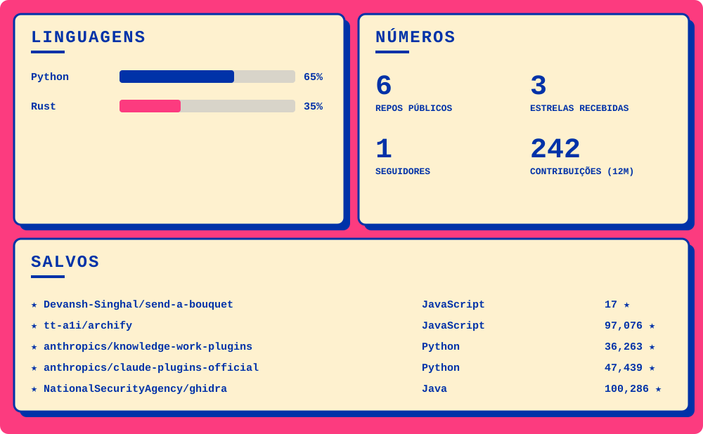
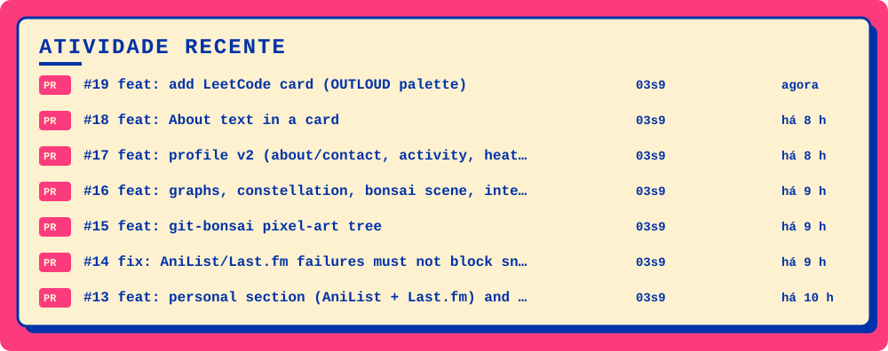
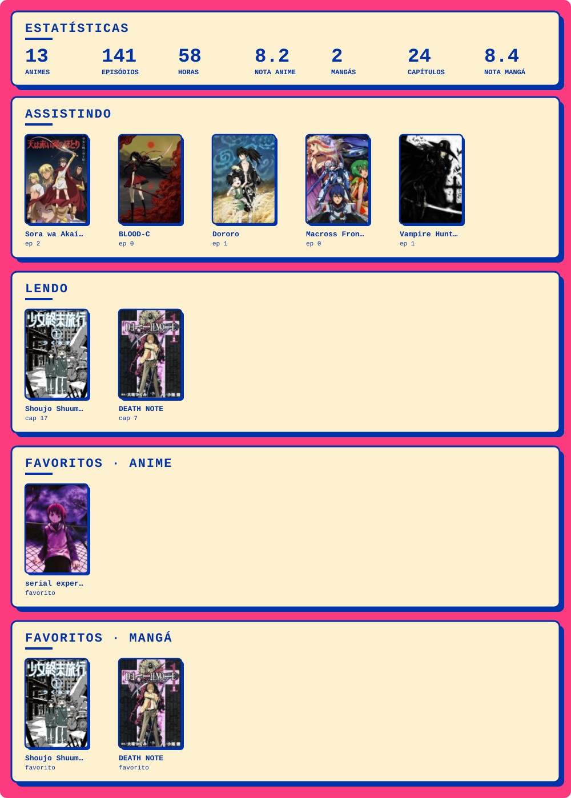
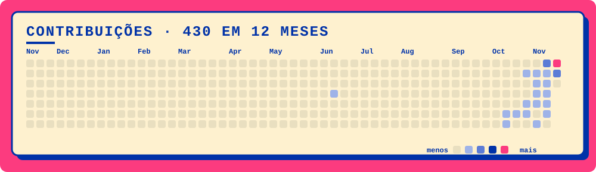

## Sobre

Sou o Vitor. Trabalho com engenharia de dados, backend e ferramentas de IA: pipelines de dados, extração de documentos, agentes e LLMs locais, e exploro motores de dados nativos em Rust. Fora do código: anime, mangá e música (mais abaixo).

<picture>
  <source media="(max-width: 600px)" srcset="assets/bento-mobile.svg">
  
</picture>

## Projetos em destaque

| Projeto | Descrição | Stack |
| --- | --- | --- |
| [arxiv-research-miner](https://github.com/03s9/arxiv-research-miner) | Mineração de papers do arXiv | Python |
| [native-data-engine-research](https://github.com/03s9/native-data-engine-research) | Pesquisa de motor de dados nativo | Rust |

## Status

<picture>
  <source media="(max-width: 600px)" srcset="assets/generated/dashboard-mobile.svg">
  
</picture>

## Atividade recente

## Pessoal & gostos

## Atividade

árvore gerada por <a href="https://github.com/egorthinks/git-bonsai">git-bonsai</a> · <a href="https://03s9.github.io/03s9/">grafos interativos no site</a>

