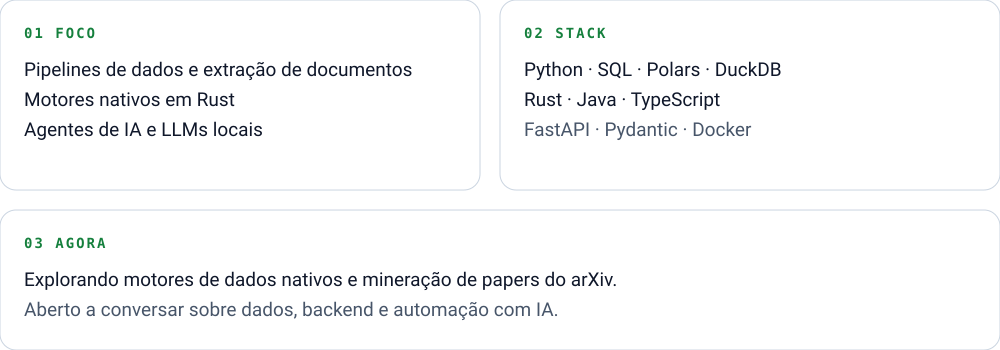

<picture>
  <source media="(prefers-color-scheme: dark)" srcset="assets/header-dark.svg">
  
</picture>

  
  
  
  
  

<picture>
  <source media="(prefers-color-scheme: dark)" srcset="assets/bento-dark.svg">
  
</picture>

## Projetos em destaque

| Projeto | Descrição | Stack |
|---|---|---|
| [arxiv-research-miner](https://github.com/03s9/arxiv-research-miner) | Mineração de papers do arXiv | Python |
| [native-data-engine-research](https://github.com/03s9/native-data-engine-research) | Pesquisa de motor de dados nativo | Rust |

## Atividade

<picture>
  <source media="(prefers-color-scheme: dark)" srcset="https://raw.githubusercontent.com/03s9/03s9/output/snake-dark.svg">
  
</picture>

  <picture>
    <source media="(prefers-color-scheme: dark)" srcset="https://github-readme-stats.vercel.app/api?username=03s9&show_icons=true&hide_border=true&bg_color=0B1120&title_color=22C55E&icon_color=38BDF8&text_color=F8FAFC">
    
  </picture>
  <picture>
    <source media="(prefers-color-scheme: dark)" srcset="https://github-readme-stats.vercel.app/api/top-langs/?username=03s9&layout=compact&hide_border=true&bg_color=0B1120&title_color=22C55E&text_color=F8FAFC">
    
  </picture>

<picture>
  <source media="(prefers-color-scheme: dark)" srcset="assets/footer-dark.svg">
  
</picture>
